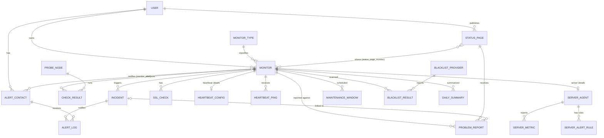

# Pulse: Architecture

> The heartbeat of your infrastructure.
> DBMS Laboratory (24CS305/CS3106) group mini project.
> Status: design phase. Items marked **(open)** are pending team decisions.

---

## 1. Overview

Pulse is a lightweight, developer-friendly monitoring tool. Users register websites and services as **monitors**; Pulse checks them on a schedule, records every result, opens **incidents** when something breaks, notifies the right people, and shows uptime, incidents and history on a minimal dashboard and optional public status page.

**Vision:** understand what is happening across your infrastructure without unnecessary complexity.

### Design principles
1. **The database is the core.** Business rules (incident open/close, SSL warnings, audit trail) live in the database as triggers, procedures, views and events, not scattered in application code.
2. **Trustworthy alerts over more alerts.** Avoid false positives with retries, failure thresholds, cooldowns and maintenance windows.
3. **Simple first.** Get the core loop (monitor, check, incident, report) working end to end before adding extras.
4. **Secure by default**, especially because users can enter arbitrary URLs.

---

## 2. Technology Stack

| Layer | Choice | Notes |
|---|---|---|
| Database | **MariaDB 10.6+** | Needs modern `CHECK` support, triggers, events |
| Backend | **Python 3 + Flask** (assumed) | Any approved stack works; Flask suits a background checker |
| DB connector | `mysql-connector-python` (or `mariadb`) | Parameterized queries only |
| Frontend | HTML, CSS, JavaScript (Jinja2 templates) | Polling for live updates |
| HTTP checks | `requests` | Timeouts, redirects, TLS info |
| Ping / port checks | `socket`, system `ping` | |
| DNS blacklist checks | `dnspython` | DNSBL lookups via a local resolver on the VM |
| Server agent | Python + `psutil` | Collects CPU, RAM, disk, network, service state; pushes over HTTPS |
| Notifications | Discord webhooks | Colour-coded embeds |
| App server | Gunicorn behind **Nginx** | Production on the VM |
| Process manager | `systemd` | Web app and checker as separate services |
| Hosting | **VM (Ubuntu)** | Local fallback for the lab demo |
| Version control | Git + GitHub (private repo) | |

---

## 3. System Architecture

```
                         +------------------------------+
   Browser  ---HTTPS--->  |  Nginx (reverse proxy, TLS)  |
 (dashboard, status page) +--------------+---------------+
                                         |
                                         v
                         +------------------------------+
                         |   Flask web app (Gunicorn)   |
                         |  auth, CRUD, reports, JSON   |
                         +--------------+---------------+
                                         |  SQL (parameterized)
                                         v
   +-------------------+     +------------------------------+
   |  Checker service  |---->|           MariaDB            |
   |  (scheduler +     |     |  tables, views, triggers,    |
   |   probe workers)  |     |  procedures, events          |
   +---------+---------+     +--------------^---------------+
             |                              |
             v                              |
   Monitored targets           +------------+-------------+
   (websites, hosts, ports)    |   Alert dispatcher       |
                               |  reads new incidents,    |
                               |  sends notifications,    |
                               |  logs delivery           |
                               +--------------------------+
```

### Components

**Web app (Flask)**
- Authentication (Admin / User roles), session handling
- CRUD for monitors, alert contacts, maintenance windows, status pages
- Dashboard, incident list, uptime reports, SSL and blacklist views
- **Charts** (response time, uptime, status timeline, incidents) drawn with Chart.js from JSON endpoints
- **Report a problem** form on the public status page, plus a triage screen for owners and admins
- JSON endpoints (`/api/...`) polled by the dashboard
- Public status page (no login)
- **Instant check** endpoint: enter any URL, get a result immediately, optionally save it as a monitor

**Checker service (separate process)**
- Scheduler loop selects monitors that are due (`last_check + interval <= now`, active, not in maintenance)
- Worker pool runs checks concurrently (`ThreadPoolExecutor`)
- **Confirmation retries:** a failed check is retried a couple of times a few seconds apart before a failure is recorded
- Writes `check_result` rows; the database trigger takes it from there
- Periodic jobs: SSL expiry checks (daily), blacklist checks (hourly), **heartbeat sweep** (flags monitors whose expected ping did not arrive)

**Alert dispatcher (separate process or thread)**
- Finds incidents or recoveries not yet notified
- Sends to each linked contact as a **Discord webhook** message (colour-coded embed: red down, amber degraded, green recovered)
- Respects per-contact **cooldown**; writes every attempt to `alert_log`, including failures

**Server agent (installed on each machine to be monitored)**
- Small Python script using `psutil`; runs as a systemd service or cron job
- Every minute it collects CPU, RAM, disk, network and selected service states, then POSTs them to `/api/agent/report` with a secret token
- Pulse installs its own agent on the VM so it monitors itself; a laptop or second machine can run the agent for the demo

**Heartbeat endpoint**
- `/api/heartbeat/<token>` receives pings from cron jobs and scheduled tasks; silence beyond the grace period becomes an incident

**Database (MariaDB)**
- Source of truth and rule engine (section 5)

---

## 4. Data Model

### 4.1 Tables

Tables are grouped by tier. **Core** tables are built first; the rest follow the roadmap.

**Core**

| Table | Purpose | Key columns |
|---|---|---|
| `user` | Accounts | user_id PK, username UNIQUE, email UNIQUE, password_hash, role CHECK(admin/user) |
| `monitor_type` | HTTP, PING, PORT, HEARTBEAT, SERVER | type_id PK, name UNIQUE |
| `monitor` | What is watched | monitor_id PK, user_id FK, type_id FK, name, target, port, interval_sec, timeout_ms, failure_threshold, expected_status, expected_keyword, degraded_ms, is_active |
| `check_result` | Every check | result_id PK, monitor_id FK, node_id FK, checked_at, status (up/down/degraded), http_code, response_ms, error_msg |
| `incident` | Outages | incident_id PK, monitor_id FK, started_at, resolved_at, status, severity, source (check/heartbeat/server/ssl/blacklist/report), cause, notes |
| `alert_contact` | Who to notify | contact_id PK, user_id FK, channel (discord), destination (webhook URL) |
| `monitor_alert` | M:N monitors and contacts | PK (monitor_id, contact_id), cooldown_min |
| `alert_log` | Notification history | alert_id PK, incident_id FK, contact_id FK, sent_at, delivery_status |
| `probe_node` | Where checks run from | node_id PK, name, location, is_active |

**Extended**

| Table | Purpose |
|---|---|
| `ssl_check` | Certificate expiry per monitor (expires_on, issuer, days_left) |
| `maintenance_window` | Planned downtime (monitor_id, starts_at, ends_at, reason) |
| `blacklist_provider` | DNSBL zones to query |
| `blacklist_result` | Listed or not, per monitor and provider |
| `heartbeat_config` | Subtype of `monitor`: token_hash, expected_every_sec, grace_sec |
| `heartbeat_ping` | Each ping received (monitor_id FK, received_at) |
| `server_agent` | Subtype of `monitor`: token_hash, hostname, os, last_seen |
| `server_metric` | Samples from the agent (agent/monitor FK, collected_at, cpu_pct, ram_pct, disk_pct, load, net_in, net_out) |
| `server_alert_rule` | Thresholds per agent (metric, operator, threshold, consecutive_samples) |
| `status_page` | Public page (slug, title, is_public) |
| `status_page_monitor` | M:N pages and monitors |
| `daily_summary` | Rolled-up stats per monitor per day (uptime %, avg ms, counts) |
| `audit_log` | Who changed what and when |
| `problem_report` | Problems reported by visitors or users (monitor_id FK, status_page_id FK, reporter_name, reporter_email, category, description, ip_hash, status, incident_id FK nullable, created_at) |

### 4.2 ER Diagram (draft)



### 4.3 Normalization notes (for the report)
- All tables are in **3NF**: no repeating groups, every non-key attribute depends on the whole key and nothing but the key.
- `monitor_type` and `probe_node` are separate lookup tables to avoid repeating values and update anomalies.
- Many-to-many relationships use junction tables (`monitor_alert`, `status_page_monitor`).
- **Supertype/subtype pattern:** every watched thing is a `monitor`; type-specific details live in 1:1 extension tables (`heartbeat_config`, `server_agent`). Incidents, alerts, maintenance windows and status pages therefore work the same for every monitor type, and no table is full of NULLs.
- `daily_summary` is intentionally **derived/denormalized** for performance (a rollup, rebuilt by a procedure); document it as a deliberate trade-off.

### 4.4 Constraints plan
- **PRIMARY KEY / FOREIGN KEY** on every relationship (`ON DELETE CASCADE` for child history, `RESTRICT` where history must be kept)
- **NOT NULL** on required fields
- **UNIQUE:** username, email, status page slug, (monitor, node, checked_at)
- **CHECK:** `interval_sec >= 30`, `timeout_ms BETWEEN 500 AND 60000`, `failure_threshold >= 1`, `port BETWEEN 1 AND 65535`, `role IN ('admin','user')`, `ends_at > starts_at`
- **DEFAULT:** `is_active = 1`, `interval_sec = 60`, `failure_threshold = 2`, timestamps `CURRENT_TIMESTAMP`

---

## 5. Database Logic

### 5.1 Triggers
| Trigger | Fires | Behaviour |
|---|---|---|
| `trg_check_result_ai` | AFTER INSERT on `check_result` | If the last *N* results (N = monitor's `failure_threshold`) are all `down` and no open incident exists, **open an incident**. If result is `up` and an incident is open, **close it**. Skips monitors inside a maintenance window. |
| `trg_ssl_check_ai` | AFTER INSERT on `ssl_check` | Flag or raise a warning incident when `days_left` is below 14 |
| `trg_server_metric_ai` | AFTER INSERT on `server_metric` | Evaluate the agent's `server_alert_rule`s; after N consecutive breaching samples open an incident (source `server`, e.g. "Disk 95% above 90%"); close when back to normal |
| `trg_blacklist_result_ai` | AFTER INSERT on `blacklist_result` | If newly listed, open a warning incident (source `blacklist`); close when delisted |
| `trg_monitor_au` / `_ad` | AFTER UPDATE/DELETE on `monitor` | Write to `audit_log` |
| `trg_problem_report_ai` | AFTER INSERT on `problem_report` | If 3 or more reports arrive for a monitor within 15 minutes and no incident is open, raise a **"possible outage" warning incident** (catches cases where the checker says up but users say down) |
| `trg_maintenance_bi` | BEFORE INSERT on `maintenance_window` | Reject overlapping windows for the same monitor |

### 5.2 Views
- `v_monitor_status`: latest status, response time and open incident per monitor (dashboard)
- `v_public_status`: safe subset for status pages (no internal fields)
- `v_incident_summary`: incidents with duration, monitor, severity
- `v_chart_response_time`, `v_chart_daily_uptime`: shaped data feeding the charts

### 5.3 Stored procedures and functions
- `sp_uptime_report(monitor_id, from, to)`: uptime %, avg/min/max response, incident count
- `sp_rollup_daily(date)`: builds `daily_summary`
- `sp_purge_old_results(days)`: deletes raw `check_result` older than the retention period
- `fn_uptime_pct(monitor_id, from, to)`: reusable function used by reports
- `sp_report_stats(monitor_id, days)`: report counts per category and status

### 5.4 Events (MariaDB event scheduler)
- `ev_daily_rollup`: runs `sp_rollup_daily` nightly
- `ev_purge`: runs `sp_purge_old_results` weekly

(Enable with `SET GLOBAL event_scheduler = ON;` and persist in the server config.)

### 5.5 Report queries (JOIN + aggregates + GROUP BY)
- Uptime %, average response time and incident count per monitor, grouped by monitor type
- Top 5 slowest monitors this week
- Mean time to resolve (MTTR) per monitor
- Incidents per day for a date range

---

## 6. Key Flows

### 6.1 Scheduled check
1. Checker selects due monitors (active, not in maintenance).
2. For each, a worker performs the check (HTTP/ping/port) with the monitor's timeout.
3. On failure, retry up to 2 times with a short delay.
4. Classify: `up`, `degraded` (slow, above `degraded_ms`), or `down` (error, wrong status, missing keyword).
5. Insert into `check_result`.
6. `trg_check_result_ai` opens or closes an incident.
7. Alert dispatcher notices the change and notifies contacts, respecting cooldown, and logs to `alert_log`.

### 6.2 Instant check (any URL)
1. Authenticated user enters a URL on the dashboard.
2. Backend validates and normalizes the URL, resolves DNS, **rejects private/internal addresses**, then performs one check.
3. Result is returned as JSON and shown at once.
4. "Save as monitor" inserts it into `monitor`; from then on it follows flow 6.1.

### 6.3 Dashboard updates
Dashboard polls `/api/status` every 10 to 30 seconds and refreshes the table without reloading. No WebSockets needed.

### 6.4 Charts
Charts are drawn in the browser with **Chart.js**. The backend serves JSON from views and the rollup table, so the heavy work stays in SQL.

| Chart | Type | Data source |
|---|---|---|
| Response time, last 24h / 7d | Line | `check_result` (aggregated into buckets for long ranges) |
| Daily uptime %, last 30/90 days | Bar | `daily_summary` |
| Status timeline strip (green/amber/red blocks) | Custom bar | `check_result` or `incident` |
| Incidents per day | Bar | `v_incident_summary` |
| Uptime by monitor type | Doughnut or bar | grouped report query |
| Response time by node | Multi-line | `check_result` grouped by `probe_node` |

Endpoints (examples): `/api/monitors/<id>/response-times?range=24h`, `/api/monitors/<id>/uptime?days=30`. The public status page shows a 90-day uptime bar per monitor.

For long date ranges, query `daily_summary` instead of raw rows so charts stay fast.

### 6.5 Report a problem
Two entry points, one table (`problem_report`):

1. **Public status page:** a visitor clicks "Report a problem", picks the affected service, a category (down, slow, error message, other), adds a description and optional email. No login needed.
2. **Logged-in users:** same form from the dashboard.

Flow:
1. Form is validated (required fields, length limits, email format) and **rate-limited per IP** (a hashed IP is stored, not the raw address).
2. Row is inserted with status `new`.
3. `trg_problem_report_ai` checks for a cluster of reports; if found, it raises a "possible outage" warning incident.
4. The monitor's owner is notified through the normal alert path.
5. Owner or admin triages: `acknowledged`, `linked` to an incident, or `dismissed`. Resolved incidents can notify reporters who left an email.

Report ideas: reports per monitor, reports per category, average time to acknowledge.

### 6.6 HetrixTools detection model, and how Pulse follows it

HetrixTools works in four steps: **send a check, inspect the response, compare with expected behaviour, notify**, repeating checks where useful to cut false alarms. Pulse follows the same pipeline:

| Step | HetrixTools | Pulse |
|---|---|---|
| 1. Send a check | Periodic HTTP/HTTPS (or ping/port) request, every minute | Checker picks due monitors and sends the request |
| 2. Inspect | Status code, connection result, response time | Stored in `check_result` (http_code, response_ms, error_msg) |
| 3. Compare | Timeout, connect failure or unexpected result is a problem; checks may repeat | Compared with `expected_status`, `expected_keyword`, `timeout_ms`, `degraded_ms`; confirmation retries; `failure_threshold` consecutive failures |
| 4. Notify | Alert through a supported channel when failure conditions are met | Trigger opens the incident, dispatcher sends a Discord message, `alert_log` records delivery |

How each type of issue is detected:

| Issue | Detection | Pulse implementation |
|---|---|---|
| Website down | Request fails or times out | Check result `down`, error captured |
| Website returns an error | Unexpected status such as 500 | `http_code` differs from `expected_status` |
| Website slow | Request duration measured | `response_ms` above `degraded_ms` gives `degraded` |
| Server RAM high | Agent reports memory usage | `server_metric.ram_pct` against `server_alert_rule` |
| Disk nearly full | Agent reports disk usage | `server_metric.disk_pct` against rule |
| IP blacklisted | Checked against external blacklists | DNSBL lookups, stored in `blacklist_result` |
| SSL certificate issue | Certificate and connection inspected | `ssl_check`: expiry, issuer, hostname match, handshake errors |
| Scheduled job did not run | Heartbeat not received | `heartbeat_ping` sweep, section 6.7 |

**Single-VM limitation:** HetrixTools confirms outages from several locations, which a single VM cannot truly do. Pulse compensates with confirmation retries and the failure threshold, keeps `probe_node` in the schema so more locations can be added, and (optional, for the demo) lets a laptop run the checker in "remote node" mode, posting results to `/api/node/report`.

### 6.7 Heartbeat monitors
1. User creates a monitor of type HEARTBEAT; Pulse generates a secret token and shows a URL like `/api/heartbeat/<token>` once (only the hash is stored).
2. The user's cron job or script calls that URL when it finishes (`curl` is enough).
3. Each call inserts a `heartbeat_ping` row.
4. The checker's heartbeat sweep compares `now - last ping` with `expected_every_sec + grace_sec`. If exceeded, it inserts a `down` row in `check_result` (error "heartbeat missed"), so the normal incident trigger and alerts apply. The next ping recovers it.

### 6.8 Server monitoring agent
1. User adds a monitor of type SERVER; Pulse generates a token and an install command for the agent.
2. The agent runs on the target machine, collecting CPU, RAM, disk, network I/O and chosen service states every minute.
3. It POSTs a JSON sample over HTTPS to `/api/agent/report`; the backend verifies the token hash and inserts `server_metric`.
4. `trg_server_metric_ai` evaluates `server_alert_rule`s (for example `disk_pct > 90` for 3 consecutive samples) and opens or closes an incident.
5. If no sample arrives for several minutes, the agent is treated as offline (same mechanism as a missed heartbeat).
6. The dashboard charts each metric over time, with threshold lines drawn on the graph.

### 6.9 Blacklist monitoring
1. Each monitor's target is resolved to its IP; the domain itself is also checked against domain-based lists.
2. Hourly, the job queries 5 to 10 DNSBL providers (reverse-IP lookup, e.g. `4.3.2.1.<zone>`). An answer in `127.0.0.x` means listed; no answer means clean.
3. Results go into `blacklist_result`; `trg_blacklist_result_ai` opens a warning incident on a new listing.
4. Some providers (such as Spamhaus) refuse queries that arrive via large public DNS resolvers, so the VM runs its own local resolver for these lookups.

---

## 7. Real-World Problems Addressed

These are the most common complaints about existing monitoring tools, and how Pulse handles each.

| Problem in real tools | Pulse approach | Tier |
|---|---|---|
| **False positives and alert fatigue** | Confirmation retries plus a per-monitor `failure_threshold`; incident only after N consecutive failures | Core |
| **One-location checks mistake local problems for outages** | `probe_node` table; results tagged by node; with 2+ nodes, require agreement before opening an incident | Core schema, optional second node |
| **Slow response mistaken for outage** | Separate `degraded` status and configurable timeout; slow is not down | Core |
| **HTTP 200 but the page is broken** | `expected_status` and `expected_keyword` content check | Core |
| **Alerts during planned work** | `maintenance_window` suppresses incidents and alerts | Extended |
| **Repeated alerts for the same incident** | `cooldown_min` per monitor-contact link; one incident, deduplicated alerts | Core |
| **Silent notification failures** | `alert_log` records delivery status; failed sends visible in UI | Core |
| **Monitoring data grows without bound** | `daily_summary` rollup plus scheduled purge of raw rows | Extended |
| **Expired certificates take sites down** | `ssl_check` with warning trigger | Extended |
| **No history of why something broke** | `incident.cause` and `notes` fields, `audit_log` | Core / Extended |
| **Per-monitor pricing and caps** | Self-hosted, no artificial limits | Inherent |
| **Cron jobs / scheduled tasks failing silently** | Heartbeat monitor type: job pings Pulse; no ping within the window means incident | Stretch |
| **Tool says "up" while real users cannot reach the site** | Visitors can report problems; a cluster of reports raises a warning incident even when checks pass | Extended |
| **Credibility of uptime numbers** | Reports computed from stored raw data via one procedure, with maintenance time excluded | Extended |

---

## 8. Security

- **Passwords:** hashed (e.g. Werkzeug `generate_password_hash`), never stored in plain text
- **SQL injection:** parameterized queries everywhere
- **Sessions and CSRF:** secure cookies, CSRF tokens on forms
- **Authorization:** role checks on every route; users see only their own monitors; admin sees all
- **SSRF protection** (arbitrary URL input): allow `http/https` only, resolve the hostname and reject loopback, private, link-local and metadata ranges, cap redirects, enforce timeouts and response size, rate-limit the instant check
- **Database:** dedicated least-privilege user; MariaDB bound to `127.0.0.1`; never expose port 3306
- **Secrets:** environment variables or a git-ignored config; commit a `config.example.py`
- **Production:** `debug=False`, HTTPS, firewall allowing only 22/80/443
- **Agent and heartbeat tokens:** long random tokens, only the hash stored, shown once, revocable; agent traffic over HTTPS only; reject oversized or malformed payloads
- **Discord webhooks:** accept only URLs on Discord's webhook host, treat the URL as a secret (hide it in the UI after saving), never log it
- **Problem reports:** rate limit per hashed IP, length caps, output escaping (to prevent stored XSS on the triage screen), optional simple challenge (e.g. honeypot field) against spam
- **Input validation:** URL format, email, port range, interval range, empty fields (client and server side)

---

## 9. Deployment

```
Ubuntu VM
 |- nginx            (80/443, reverse proxy, TLS)
 |- gunicorn         (Flask app, systemd service: pulse-web)
 |- checker.py       (systemd service: pulse-checker)
 |- dispatcher.py    (systemd service: pulse-alerts, or thread in checker)
 |- unbound          (local DNS resolver for blacklist lookups)
 `- mariadb-server   (localhost only)
```

- Services restart on failure and start on boot via systemd.
- **Single VM:** the web app, checker, dispatcher, database and Pulse's own server agent all run on it; the VM monitors itself.
- Database is built from numbered scripts in `sql/` (and one merged `pulse.sql` for submission).
- **Demo plan:** run on the VM; keep a local laptop copy as fallback; be ready to rebuild the database from the SQL script on request.

---

## 10. Project Structure

```
pulse/
|- app/
|  |- __init__.py          # Flask app factory
|  |- routes/              # auth, monitors, incidents, reports, status, api
|  |- db.py                # connection helper
|  |- security.py          # SSRF guard, validators
|  |- templates/
|  `- static/
|- services/
|  |- checker.py           # scheduler + workers
|  |- dispatcher.py        # notifications
|  `- jobs.py              # SSL, blacklist, rollups
|- sql/
|  |- 01_schema.sql
|  |- 02_views.sql
|  |- 03_procedures.sql
|  |- 04_triggers.sql
|  |- 05_events.sql
|  `- 06_sample_data.sql
|- agent/
|  `- pulse_agent.py       # server monitoring agent (psutil)
|- deploy/                 # nginx conf, systemd unit files
|- docs/                   # ER diagram, screenshots, report
|- config.example.py
|- requirements.txt
|- architecture.md
`- README.md
```

---

## 11. Roadmap

| Phase | Deliverable |
|---|---|
| 1 | Finalize stack and scope; ER diagram; `01_schema.sql` with constraints |
| 2 | Core app: login, monitor CRUD, instant check, DB connectivity |
| 3 | Checker with retries, `check_result`, incident trigger |
| 4 | Dashboard, alerts and `alert_log`, uptime report, search/filter |
| 5 | Views, procedures, events; sample data (10+ rows per major table) |
| 6 | Extended features: charts, problem reports, SSL, maintenance windows, status page |
| 7 | Heartbeat monitors, blacklist monitoring, server agent |
| 8 | VM deployment; testing; screenshots; consolidated report; demo rehearsal |

**Scope rule:** finish Core before Extended; treat Stretch items as future enhancements unless time remains.

---

## 12. Testing Plan (summary)

- Valid and invalid input on every form (empty fields, bad URL/email/port/dates)
- Check results for: healthy site, nonexistent domain, closed port, slow endpoint, wrong status, missing keyword
- Trigger behaviour: incident opens only after threshold, closes on recovery, suppressed in maintenance
- Cooldown and duplicate-alert behaviour
- Heartbeat: ping received on time, missed ping opens incident, next ping recovers
- Server agent: metrics stored, threshold breach for N samples opens incident, agent offline detected, bad token rejected
- Blacklist: use a DNSBL test entry (127.0.0.2) to confirm a "listed" result and incident
- Discord: successful delivery, invalid webhook, failure recorded in `alert_log`
- Role access (user cannot see another user's monitors)
- Charts render correctly for empty, partial and full data ranges
- Problem reports: valid and invalid submissions, rate limiting, cluster trigger, triage status changes, script injection in the description is escaped
- SSRF attempts (`127.0.0.1`, `192.168.x.x`, `169.254.169.254`) rejected
- Fresh database rebuild from SQL scripts

---

## 13. Decisions

**Decided**
- Database: MariaDB; hosting: the team's own VM
- **One VM only** (single probe node; remote-node mode optional for demo)
- Alert channel: **Discord** webhooks
- **Blacklist monitoring** and **heartbeat monitors** are in scope
- HetrixTools-style detection model, including a server monitoring agent

**Assumed (change if needed)**
- Backend: Python + Flask

**Still open**
- Team size and member roles (database, backend, frontend, report/testing)
- Topic approval and final submission deadlines
- Whether the lab network allows outbound DNS and HTTPS to Discord during the demo (have a fallback plan)
