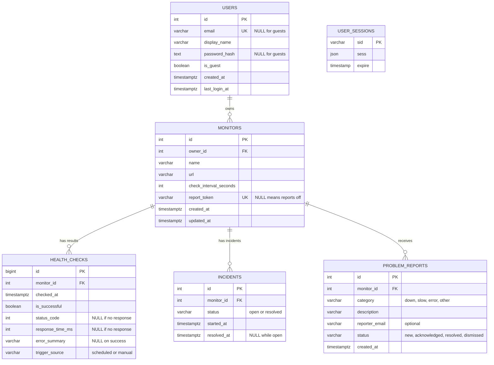

# Pulse: Architecture
> The heartbeat of your infrastructure.
> DBMS Laboratory (24CS305/CS3106) group mini project.
> This document describes the design only. SQL, schema files and application code live in the repository (`backend/drizzle/`, `backend/src/`).
## 1. Overview
Pulse is a lightweight monitoring tool for HTTP and HTTPS sites. Users register sites as **monitors**; Pulse checks them on a schedule, records every result, opens **incidents** when something breaks, and shows status, history, uptime and response-time charts on a minimal dashboard. An opt-in, unguessable **report link** per monitor lets anyone report a problem. **Vision:** the heartbeat of your infrastructure, without unnecessary complexity.
### Design principles
(1) **The database is the core.** The incident lifecycle, the guest limit and data retention live in PostgreSQL as triggers, constraints, views, a function and a procedure, not scattered in application code. (2) **Every table earns its place.** Each table supports a feature that works end to end. (3) **Simple first.** One Express process, one in-process scheduler, no queue or broker; the core loop (monitor, health check, incident, report) works before any extra. (4) **Secure by default**, especially because users can enter arbitrary URLs: SSRF guard, server-side ownership checks, input validation.
### Scope
**Included**
The core loop: **monitor, health check, incident, report**; DBMS showcase pieces: `v_monitor_status` view, uptime-summary function, incident trigger, partial unique index, `CHECK` constraints, deliberate foreign-key behaviour; SSRF safeguards, ownership checks, input validation; Search and filter, check history, response-time and uptime charts; Accounts with a guest tier (up to 2 monitors); ownership-based authorization, no RBAC; Data retention as a stored procedure; Opt-in report link per monitor for problem reports. **Not included:** admin role, WebSockets, notification channels (Discord, email, Telegram, SMS), heartbeat, blacklist, SSL-expiry and server-agent monitoring, public status page. **Deferred** (architecture stays extensible): alert notifications, maintenance windows, SSL expiry checks, more monitor types, multi-region probes, public status page. Pulse uses **6 tables** (5 domain tables plus the session store).
## 2. Technology Stack
| Layer | Choice |
|---|---|
| Frontend | React, Vite, Tailwind CSS, React Router, Recharts (history charts only), TypeScript |
| Backend | Node.js, Express, TypeScript (`tsx` in dev, `tsc` for build) |
| ORM and migrations | Drizzle ORM, Drizzle Kit |
| Database | PostgreSQL, accessed through the `pg` driver |
| Auth | Server-side sessions (`express-session` with `connect-pg-simple`, so no Redis), Argon2id password hashing (bcrypt is the fallback if native install fails on some machines) |
| Validation | `zod` on the backend, light validators on the frontend |
| Testing | Vitest and Supertest (API and lifecycle), plain SQL scripts for DB objects |

Not used: Prisma, Sequelize, Knex, TypeORM, Flask, Python, a second ORM, Redis, message brokers, microservices, Kubernetes, external agents, cloud services.
## 3. System Architecture
### 3.1 System diagram
```
 Browser (React SPA)
      |  JSON over HTTP, session cookie
      v
 +--------------------------------------------------------------+
 |  Express application (single process)                        |
 |   middleware: session, origin check, rate limit, validation  |
 |   routes -> controllers -> services -> db/queries            |
 |   health/ : ssrfGuard, checker, scheduler (setInterval)      |
 +-------------------------+------------------------------------+
                           |  Drizzle + pg (parameterized SQL)
                           v
 +--------------------------------------------------------------+
 |  PostgreSQL                                                  |
 |   tables + constraints   views   function/procedure          |
 |   triggers: incident lifecycle, guest monitor limit          |
 |   user_sessions (session store)                              |
 +--------------------------------------------------------------+

 Monitored targets: real HTTP/HTTPS sites, or the local demo target (port 4100)
 Public visitors: report page for one monitor, reached through its report link
```
### 3.2 Who owns what (no duplicated logic)
| Concern | Express service | PostgreSQL |
|---|---|---|
| Validate input, authenticate, authorize ownership | Yes | No |
| SSRF guard, perform the HTTP request, measure time | Yes | No |
| Record a check result | **Only writer** of `health_checks` (a single INSERT) | Constraints validate the row |
| **Incident lifecycle** (open, deduplicate, resolve) | **Never writes `incidents`** | **Sole owner**, via trigger on `health_checks` |
| Problem reports | Validates, rate-limits, stores | Constraints; `recent_reports_15m` computed in `v_monitor_status` |
| Guest limit of 2 monitors | Maps the error to HTTP 403 | **Authoritative**, via trigger |
| Current status, last check, durations, uptime | Reads views and function | Computes them (views, function) |
| Data retention | Calls the procedure on a schedule | Procedure deletes old rows |

Rule for code review: application code contains no `INSERT`, `UPDATE` or `DELETE` on `incidents` (cascade deletes from `monitors` and `users` aside). A lifecycle integration test enforces the behaviour.
### 3.3 Users and access levels
| State | Created by | Can do |
|---|---|---|
| Anonymous (no session) | N/A | See login, register and "Continue as guest" |
| Public visitor (no session) | A monitor's report link | Submit a problem report for that one monitor, nothing else |
| **Guest** | `POST /api/auth/guest` | Full monitor features on **at most 2 monitors**; data is temporary |
| **Registered** | `POST /api/auth/register` | Full monitor features; account page (profile, password change, delete account) |

A guest is a real row in `users` with `is_guest = true` and no email or password. This keeps one ownership model: every monitor has a non-null `owner_id`. Registering from a guest session **upgrades that same row** inside a transaction, so the guest's monitors and history are kept. Stale guests are removed by a scheduled `DELETE` (guests older than 7 days).
### 3.4 REST API summary
Base path `/api`, JSON in and out, session cookie `pulse.sid`. Success bodies use camelCase; lists return items, page, pageSize and total (default page size 20, max 100). Errors carry a code, a message and optional field details. Another user's resource returns **404**, not 403, so existence is not leaked.

| Code | HTTP | Meaning |
|---|---|---|
| `VALIDATION_ERROR` | 422 | Body or query failed validation (`details` lists fields) |
| `URL_NOT_ALLOWED` | 422 | URL blocked by the SSRF guard |
| `UNAUTHENTICATED` | 401 | No valid session |
| `INVALID_CREDENTIALS` | 401 | Wrong email or password (same message for both) |
| `NOT_FOUND` | 404 | Missing, or owned by someone else |
| `EMAIL_TAKEN` | 409 | Email already registered |
| `DUPLICATE_URL` | 409 | Owner already monitors this URL |
| `GUEST_LIMIT_REACHED` | 403 | Guest already has 2 monitors; register to add more |
| `RATE_LIMITED` | 429 | Too many requests |

| Endpoint | Auth | Purpose |
|---|---|---|
| `POST /auth/register` | none or guest | Create account; upgrades a guest session in place |
| `POST /auth/login`, `POST /auth/logout` | none, session | Log in and out |
| `POST /auth/guest`, `GET /auth/me` | none, session | Start a guest session; current user (`monitorLimit` is 2 for guests, null otherwise) |
| `PATCH /account`, `POST /account/password`, `DELETE /account` | session | Profile, password change, delete account |
| `GET /monitors`, `POST /monitors` | session | List (`search`, `status`, paging); create (403 `GUEST_LIMIT_REACHED` at 2 for guests) |
| `GET/PATCH/DELETE /monitors/:id` | session | Read, edit, delete (owner only) |
| `POST /monitors/:id/check` | session | Manual check (10 per minute per user) |
| `GET /monitors/:id/history` | session | Check history, filter by result and date |
| `GET /monitors/:id/summary` | session | Uptime summary for 24h, 7d or 30d from `fn_monitor_uptime_summary` |
| `GET /monitors/:id/response-times` | session | Chart buckets (hour or day) |
| `POST/DELETE /monitors/:id/report-link` | session | Enable or rotate / disable the report link |
| `GET /problem-reports`, `PATCH /problem-reports/:id` | session | List; triage (`acknowledged`, `resolved`, `dismissed`) |
| `GET/POST /public/report/:token` | none | Monitor name and status; submit a report (honeypot field `website` must be empty) |
| `GET /incidents` | session | Incidents from `v_incident_details`, filter by status and monitor |
| `GET /dashboard`, `GET /health` | session, none | Dashboard totals; liveness plus DB round trip |

Rules: public submissions are limited to 5 per hour per IP and 30 per hour per token; unknown and disabled tokens give the same 404; the public page exposes only the monitor name and its up or down status. Every query that touches a monitor, check, incident or report includes the owner (`monitors.owner_id = :currentUserId`) or reads from a view filtered by `owner_id`; a route never trusts an id alone.
## 4. Data Model
### 4.1 Relational schema
```
users(id PK, email UNIQUE NULL, display_name NULL, password_hash NULL, is_guest NOT NULL DEFAULT false, created_at NOT NULL DEFAULT now(), last_login_at NULL)
monitors(id PK, owner_id FK -> users.id ON DELETE CASCADE, name NOT NULL, url NOT NULL, check_interval_seconds NOT NULL DEFAULT 60, report_token UNIQUE NULL, created_at, updated_at, UNIQUE(owner_id, url))
health_checks(id PK, monitor_id FK -> monitors.id ON DELETE CASCADE, checked_at NOT NULL DEFAULT now(), is_successful NOT NULL, status_code NULL, response_time_ms NULL, error_summary NULL, trigger_source NOT NULL DEFAULT 'scheduled')
incidents(id PK, monitor_id FK -> monitors.id ON DELETE CASCADE, status NOT NULL DEFAULT 'open', started_at NOT NULL DEFAULT now(), resolved_at NULL)
problem_reports(id PK, monitor_id FK -> monitors.id ON DELETE CASCADE, category NOT NULL, description NOT NULL, reporter_email NULL, status NOT NULL DEFAULT 'new', created_at NOT NULL DEFAULT now())
user_sessions(sid PK, sess NOT NULL, expire NOT NULL)
```
### 4.2 ER diagram

`USER_SESSIONS` is infrastructure for `express-session`; it deliberately has no foreign key (the user id lives inside the session JSON). Cardinality: one user owns many monitors; one monitor has many health checks, incidents and problem reports (at most one incident open at a time).
### 4.3 Normalization to 3NF (for the report)
#### 4.3.1 Approach
**1NF:** every column is atomic; no repeating groups (a monitor's checks and incidents are rows in their own tables, not arrays or columns); **2NF:** every table has a single-column surrogate primary key, so no partial dependencies are possible; **3NF:** no non-key attribute depends on another non-key attribute.
#### 4.3.2 Functional dependencies
| Table | Dependencies | 3NF? |
|---|---|---|
| `users` | `id` determines all columns; `email` determines `id` (candidate key) | Yes |
| `monitors` | `id` determines all columns; `(owner_id, url)` is a candidate key | Yes |
| `health_checks` | `id` determines all columns | Yes |
| `incidents` | `id` determines all columns | Yes, see 4.3.4 |
| `problem_reports` | `id` determines all columns | Yes |
| `user_sessions` | `sid` determines `sess`, `expire` | Yes |
#### 4.3.3 Derived data is not stored
Current status, last check time, last response time, open-incident flag, recent report count, incident duration, failed-check counts, uptime percentage and min/avg/max response times are all **computed** by views and a function. Storing them (for example `monitors.last_status` or `monitors.last_checked_at`) would create update anomalies, so the design avoids it.
#### 4.3.4 Two deliberate, guarded redundancies (to explain in the viva)
`incidents.status` is determined by whether `resolved_at` is null. The project specification asks the incident to record its status, and a status column gives readable filtering and a clean partial index. The lifecycle `CHECK` makes divergence impossible; `users.is_guest` is determined by whether `email` is null. A boolean is clearer to query and to index; the guest-shape `CHECK` keeps the two in lockstep. `health_checks.is_successful` is a recorded fact (the policy applied at check time), not a recomputable value, so it is not a redundancy.
#### 4.3.5 Decisions that avoid anomalies
Incidents do **not** store foreign keys to the opening or resolving check. Because the incident's monitor would then be derivable from two places, it could drift. Instead, the failed checks belonging to an incident are found by a time-range join (`v_incident_details`); No lookup tables for statuses; a `CHECK` list is simpler and migrates more easily than a PostgreSQL enum.
### 4.4 Constraints plan
#### 4.4.1 Constraints and deletion behaviour
| Table | Constraint | Purpose |
|---|---|---|
| `users` | `CHECK` guest shape: guest rows have no email or password; registered rows have both and a display name | One row type cannot masquerade as the other |
| `users` | `CHECK (email = lower(email))`, `UNIQUE (email)` | Case-insensitive unique email |
| `monitors` | `UNIQUE (owner_id, url)` | No duplicate URL per owner |
| `monitors` | `CHECK` interval between 30 and 3600; `CHECK` URL starts with `http://` or `https://`; `CHECK` name not blank | Defence in depth behind API validation |
| `health_checks` | `CHECK` status code null or 100 to 599; response time null or >= 0 | Valid measurements |
| `health_checks` | `CHECK` success has no error text and failure has error text | Consistent outcome |
| `health_checks` | `CHECK` trigger source in (`scheduled`, `manual`) | Controlled vocabulary |
| `incidents` | `CHECK` status in (`open`, `resolved`) | Controlled vocabulary |
| `incidents` | `CHECK` lifecycle: open means `resolved_at` is null; resolved means `resolved_at` is set and >= `started_at` | Status and timestamp can never disagree |
| `incidents` | **Partial unique index** on `(monitor_id) WHERE status = 'open'` | **At most one open incident per monitor, enforced by the database** |
| `monitors` | `UNIQUE (report_token)` | Report links cannot collide |
| `problem_reports` | `CHECK` category in (`down`, `slow`, `error`, `other`); `CHECK` status in (`new`, `acknowledged`, `resolved`, `dismissed`); `CHECK` description length 10 to 1000 | Controlled values, no empty reports |

Foreign-key behaviour is deliberate: deleting a user cascades to their monitors; deleting a monitor cascades to its checks, incidents and problem reports. Nothing uses `SET NULL`, because no table keeps history that should outlive its parent.
#### 4.4.2 Indexes
| Index | Reason |
|---|---|
| `monitors (owner_id, url)` unique | Duplicate prevention; also serves owner-scoped lookups, so no separate owner index |
| `health_checks (monitor_id, checked_at DESC)` | Latest check per monitor, history pages, charts, scheduler |
| `incidents (monitor_id, started_at DESC)` | Incident list per monitor |
| `incidents (monitor_id) WHERE status = 'open'` unique | Rule enforcement and fast open-incident lookup |
| `problem_reports (monitor_id, created_at DESC)` | Report lists and the 15-minute count |
| `user_sessions (expire)` | Session pruning |

Text search uses `ILIKE`, which is fine at this scale. A `pg_trgm` index is an optional future step and is not required.
### 4.5 ORM: Drizzle
Drizzle schema files (`backend/src/db/schema.ts`) are the **single source of truth for tables, constraints and indexes** and mirror 4.1 and 4.4 one to one, including the partial unique index and the lifecycle `CHECK` on `incidents`. Views are created by SQL migrations and are only mapped for typing (`pgView(...).existing()`), so Drizzle never tries to create or drop them.

| Use | Tool |
|---|---|
| Ordinary CRUD, simple filters | Drizzle query builder |
| Nested reads | Drizzle relational queries |
| Aggregates, `GROUP BY`/`HAVING`, chart buckets, view and function calls | Explicit parameterized SQL through Drizzle's `sql` template |
| Transactions | `db.transaction` |

All explicit SQL lives in `backend/src/db/queries/*.ts`, one function per query, each with a comment explaining it. That folder is the **query catalogue** (section 5.5).
### 4.6 Migration strategy
One folder, `backend/drizzle/`, one ordered journal, applied by `drizzle-kit migrate`. **Generated** files (`drizzle-kit generate`, a diff of `schema.ts`) hold tables, constraints and indexes; **custom SQL** files (`drizzle-kit generate --custom`) hold views, functions, procedures and triggers.

| File | Kind | Content |
|---|---|---|
| `0000_init_tables.sql` | Generated | 6 tables, constraints, partial unique index, other indexes |
| `0001_views.sql` | Custom | `v_monitor_status`, `v_incident_details` |
| `0002_functions_procedures.sql` | Custom | `fn_monitor_uptime_summary`, `fn_guest_monitor_limit`, `sp_purge_old_checks` |
| `0003_triggers.sql` | Custom | Incident lifecycle trigger, guest limit trigger |

Rules that prevent drift:
Tables, constraints and indexes change only in `schema.ts`, then are generated; never hand-write `ALTER TABLE` in a custom migration; Views, functions, procedures and triggers change only in custom migrations; never edit an applied migration, add a new one with `CREATE OR REPLACE`; Never use `drizzle-kit push` on shared databases; run `drizzle-kit check` before merging; The application never alters schema at runtime; a startup check fails fast if migrations are not applied.
## 5. Database Logic
These objects are created by the custom SQL migrations (section 4.6). Each has a job; none exists only to satisfy a checklist.
### 5.1 Triggers (`0003_triggers.sql`)
| Trigger | Fires | Behaviour |
|---|---|---|
| `trg_health_checks_incident_lifecycle` | AFTER INSERT on `health_checks`, per row | **Failed check:** open an incident for the monitor unless one is already open (the partial unique index makes this race-free; a conflict is ignored). **Successful check:** resolve the monitor's open incident, setting `resolved_at` to the check time but never earlier than `started_at`, so out-of-order timestamps are safe. This is the **only** place `incidents` is written. |
| `trg_monitors_guest_limit` | BEFORE INSERT on `monitors`, per row | Locks the owner's `users` row so two simultaneous inserts cannot both slip under the limit. If the owner is a guest and already has `fn_guest_monitor_limit()` (2) monitors, it raises an error with SQLSTATE `GL001`. The API checks both the error and its cause (Drizzle may wrap driver errors) and returns HTTP 403 `GUEST_LIMIT_REACHED`. |
### 5.2 Views (`0001_views.sql`)
| View | Contents | Used by |
|---|---|---|
| `v_monitor_status` | One row per monitor: its latest check (id, time, status code, response time, error), derived `current_status` (`unknown`, `up` or `down`), `has_open_incident`, open-incident start time, and `recent_reports_15m` (non-dismissed problem reports in the last 15 minutes). The latest check comes from a `LATERAL` subquery; the open incident from a `LEFT JOIN` that yields at most one row because of the partial unique index. | Dashboard, monitor list, scheduler |
| `v_incident_details` | One row per incident with monitor name, URL and owner, duration in seconds (up to now while open), number of failed checks during the incident and the first error. Failed checks are found by a time-range `LATERAL` join on `health_checks`, so incidents need no foreign keys to checks. | Incident list |
### 5.3 Functions and procedure (`0002_functions_procedures.sql`)
| Object | Kind | Behaviour |
|---|---|---|
| `fn_monitor_uptime_summary(monitor, from, to)` | SQL function, `STABLE` | Returns total checks, successful checks, uptime %, average, minimum and maximum response time (successful checks only) and incident count for one monitor over a window, using aggregates with `FILTER`. The API checks ownership before calling it. |
| `fn_guest_monitor_limit()` | SQL function, `IMMUTABLE` | Returns 2; single source of truth read by the guest-limit trigger and by the API for display. |
| `sp_purge_old_checks(days)` | Procedure (`CALL`) | Deletes `health_checks` older than the retention period; refuses values below 7 days. |
### 5.4 Scheduled jobs
PostgreSQL has no event scheduler in this design. The in-process scheduler tick (every 15 seconds) selects due monitors. A daily tick calls the procedure `sp_purge_old_checks` with a 30-day retention and deletes guest users older than 7 days.
### 5.5 Query catalogue (explicit SQL, each explainable in the viva)
| Query | Purpose | SQL concepts |
|---|---|---|
| Dashboard totals | Monitors, up, down, unknown and open incidents for one user | Aggregate over a view, `COUNT ... FILTER` |
| Search and filter | Monitors by name or URL text and by status, paged | Parameterized, owner-scoped, `ILIKE` |
| Recent activity | Latest 10 checks across a user's monitors | `JOIN` |
| Chart buckets | Average, min, max response, checks, failures and uptime % per hour or day | `GROUP BY`, `date_trunc` (unit whitelisted in code), `FILTER` |
| Repeated incidents | Monitors with 2 or more incidents in 30 days and average minutes to resolve | `JOIN`, `GROUP BY`, `HAVING` |
| Due monitors | Up to 50 monitors never checked or past their interval, oldest first | View, `NULLS FIRST` ordering |
| Uptime summary | Uptime and response statistics for one monitor over a window | Function call |
| Report clusters | Monitors with 3 or more non-dismissed reports in 24 hours, with the number of "down" reports | `JOIN`, `GROUP BY`, `HAVING`, `FILTER` |
| New-report badge | Count of reports with status `new` for the owner | `JOIN`, `COUNT` |
### 5.6 Transactions (multi-step operations)
| Operation | Steps inside one transaction |
|---|---|
| **Run a check** | Insert `health_checks` row (trigger updates incidents), then read back `v_monitor_status` and the open incident, so the response is one consistent snapshot. The HTTP request itself runs **before** the transaction. |
| **Register from a guest session** | Lock the guest row, verify it is still a guest, verify the email is free, `UPDATE users` (email, name, hash, `is_guest = false`). Monitors are kept automatically. Regenerate the session after commit. |
| **Delete account** | Verify password, delete from `user_sessions` where `sess->>'userId'` matches, then `DELETE FROM users` (cascades to monitors, checks, incidents, reports). |
## 6. Key Flows
### 6.1 Scheduled check
(1) Every 15 seconds the scheduler selects due monitors (`v_monitor_status` where last check is null or older than the interval), at most 50. (2) Skips monitors already being checked (in-memory set), runs at most 5 at a time. (3) Same steps 2 to 4 as above, with `trigger_source = 'scheduled'`. No DB transaction is held open during the network call.
### 6.2 Manual check
Endpoint: `POST /api/monitors/:id/check`

(1) Authenticate, load the monitor **scoped to the owner** (404 if not theirs). (2) `ssrfGuard` validates the URL and resolves DNS (section 8). (3) `checker` performs the request with timeout and size cap, records time and outcome. (4) In one transaction: `INSERT` into `health_checks`; the trigger updates `incidents`; read back `v_monitor_status` and the open incident. (5) Respond with the check, the monitor summary and the open incident (or null).
### 6.3 Status policy
HTTP 200 to 399 after at most 3 redirects is `up`. HTTP 400 and above, timeouts, DNS or connection or TLS errors, and blocked destinations are `down` with an `error_summary`. Response time is measured until response headers arrive.
### 6.4 Report a problem
(1) The owner enables a report link on a monitor; Pulse generates a random 32-character token. (2) Anyone with the link sees the monitor's name and current up or down status, plus a short form (category, description, optional email). (3) The submission is validated, rate-limited and stored in `problem_reports` with status `new`. (4) The owner sees a "new reports" count on the dashboard and monitor list and triages each report (`acknowledged`, `resolved`, `dismissed`). `v_monitor_status.recent_reports_15m` highlights a monitor that receives several reports while its checks still pass (users may see a problem the checker misses). Reports never change incidents; the lifecycle stays owned by the trigger.
### 6.5 Runtime assumption
One Express process runs the scheduler. This is documented, not hidden.
## 7. Real-World Problems Addressed
| Problem | Pulse approach |
|---|---|
| **Duplicate incidents under concurrent failures** | Partial unique index plus `ON CONFLICT DO NOTHING`; at most one open incident per monitor |
| **Status and timestamps disagree** | Lifecycle `CHECK` on `incidents` |
| **Derived values drift** | Status, uptime and durations are computed by views and a function, never stored |
| **Monitoring data grows without bound** | `sp_purge_old_checks` on a daily tick (minimum retention 7 days) |
| **Tool says "up" while users cannot reach the site** | Report link per monitor; `recent_reports_15m` highlights several reports while checks pass |
| **Arbitrary URL reaches the internal network** | SSRF guard on save and on every check, validated DNS lookup, manual redirects |
| **Guests abuse the free tier** | Database-enforced limit of 2 monitors (row lock); stale guests deleted after 7 days |
| **One user reads another's data** | Owner-scoped queries; other users' resources return 404 |
## 8. Security
### Authentication and sessions
Argon2id (or bcrypt cost 12+) hashes, never logged or returned; minimum length 10; email lower-cased; Generic login failure message; cookie `HttpOnly`, `SameSite=Lax`, `Secure` in production; session id regenerated on login, register and guest upgrade; Sessions stored in PostgreSQL (`user_sessions`); logout and account deletion destroy them; strong `SESSION_SECRET` from the environment.
### Authorization
Every user-scoped query includes the owner; other users' resources return 404; an automated isolation test covers every endpoint; Guest limit enforced by the database trigger.
### SSRF and outbound requests
Only `http` and `https`, no credentials in the URL, maximum length 2048; production ports 80, 443, 8080, 8443; DNS resolved and **every** address checked against blocked ranges (loopback, private, link-local including cloud metadata `169.254.0.0/16`, `100.64.0.0/10`, `0.0.0.0/8`, multicast, IPv6 `::1`, `fc00::/7`, `fe80::/10`, IPv4-mapped IPv6); a custom `lookup` validates the address actually dialled (stops DNS rebinding); Redirects followed manually (max 3, each hop re-validated); 10 second timeout; body not read beyond 64 KB; Validation on save **and** on every check; `SSRF_ALLOWLIST` is exact `host:port` only and empty in production.
### Input validation and injection
- `zod` on every body, query and path parameter; all SQL parameterized (sort column and `date_trunc` unit whitelisted); output escaped by React; `CHECK` constraints back up API validation
### Public problem reports
Token: 32 random characters from `crypto.randomBytes`, unique, rotatable, can be disabled; unknown and disabled tokens give the same 404; JSON only, size and field limits (description 10 to 1000), email check, honeypot, rate limits per IP and per token; Public page reveals only the monitor name and up or down status; descriptions rendered as plain text.
### Abuse and platform hardening
In-memory rate limits: login 10 per 15 minutes, register 5 per hour, guest creation 5 per hour, manual check 10 per minute; `helmet` headers, origin check on mutating requests, errors never expose SQL or stack traces, no secrets in the repository, app database user has no superuser rights.
## 9. Deployment and Setup
Pulse runs locally for the lab demo; hosting is optional. With `NODE_ENV=production` Express serves `frontend/dist`, so production is one Node process in front of PostgreSQL. Requirements: Node.js 20+, PostgreSQL 15+, Git, `psql`. **Steps**
(1) Create a PostgreSQL role `pulse` and two databases it owns: `pulse` (application) and `pulse_test` (automated tests). (2) Copy `backend/.env.example` to `.env` and set `SESSION_SECRET`. (3) In `backend`: install dependencies, run migrations, seed the demo data, start the API (port 4000). (4) Start the demo target server (port 4100). (5) In `frontend`: install dependencies and start the dev server (port 5173), which proxies `/api` to the API.

**Environment variables**

| Variable | Purpose |
|---|---|
| `DATABASE_URL`, `TEST_DATABASE_URL` | Application and test databases |
| `SESSION_SECRET` | Signs session cookies; the app refuses to start in production without it |
| `FRONTEND_ORIGIN`, `PUBLIC_BASE_URL` | Allowed origin; base URL used in report links |
| `SCHEDULER_ENABLED`, `SCHEDULER_TICK_SECONDS` | Scheduler switch and tick length (15 seconds) |
| `CHECK_TIMEOUT_MS` | Health check timeout (10,000 ms) |
| `SSRF_ALLOWLIST` | Exact `host:port` pairs allowed despite the SSRF guard (demo target only; empty in production) |

| Task | Command |
|---|---|
| Change tables or constraints | edit `schema.ts`, `npm run db:generate`, `npm run db:migrate` |
| Add or change a view, function or trigger | `npm run db:custom -- --name=<n>`, write SQL, `npm run db:migrate` |
| Check migration history | `npm run db:check` |
| Clean demo state (development only) | `npm run db:reset`, then `npm run db:seed` |
| Run tests / produce the submission SQL file | `npm test` (uses `pulse_test`) / `npm run db:dump` |
## 10. Project Structure
```
pulse/
|- backend/
|  |- drizzle/             # migrations: 0000 tables, 0001 views, 0002 functions/procedure, 0003 triggers
|  |- src/
|  |  |- db/               # client, schema.ts, relations.ts, views.ts, queries/ (the query catalogue)
|  |  |- middleware/       # session, requireUser, originCheck, rateLimit, validate, errorHandler
|  |  |- modules/          # auth, account, monitors, incidents, reports, public, dashboard
|  |  |- health/           # ssrfGuard, checker, checkService, scheduler
|  |  `- server.ts, app.ts, config/env.ts, lib/
|  |- scripts/             # seed.ts, reset-db.ts, dump-sql.ts
|  |- demo/target-server.ts
|  `- tests/               # db/ (constraints, trigger, function), api/ (Supertest), health/ (SSRF, lifecycle)
|- frontend/src/
|  |- api/                 # the only code that calls fetch
|  |- auth/, hooks/, lib/
|  |- pages/               # Login, Register, Dashboard, Monitors, MonitorForm, MonitorDetail, Incidents, Reports, PublicReport, Account
|  `- components/          # layout, ui, charts (Recharts)
|- docs/                   # api.md, ER diagram, demo script, test plan, report
`- README.md, architecture.md, .gitignore
```
Layering is deliberately thin: `routes -> controller -> service -> db/queries`.
## 11. Roadmap
Phases assume roughly three weeks.

| Phase | Done when |
|---|---|
| 0 Foundations | Repository, `.env.example`, database role documented; both apps start; `npm run dev` works |
| 1 Schema and DB objects | `db:migrate` on an empty database creates 6 tables, views, function, procedure, triggers. SQL tests: each `CHECK` rejects bad rows; a second failing check opens no second incident; success resolves; a failure after recovery opens a **new** incident; 10 concurrent failing inserts leave one open incident; a guest's third monitor is rejected with `GL001`, including under concurrency; `db:check` passes and no `ALTER TABLE` appears in custom migrations |
| 2 Auth and accounts | Register, login, logout, guest, profile, password change and delete account work in the UI; guest upgrade keeps monitors; cookie flags and Argon2id as in section 8 |
| 3 Monitor management | CRUD with search and status filter; a second user gets 404 everywhere (automated); duplicate URL 409, invalid URL 422, guest limit 403 with a "register to add more" prompt |
| 4 Health engine | Manual check records status code, response time, timestamp, error summary, source; timeout, refused connection, DNS failure and 5xx give readable errors; SSRF tests pass; scheduler never overlaps runs or holds a transaction during network calls; demo target switches modes |
| 5 Dashboard, history, charts | Totals and recent checks; paginated history; incident list; detail page with uptime summary (SQL function) and two charts for 24h, 7d, 30d; loading, empty and error states |
| 6 Problem reports | Owner enables, rotates and disables a report link; a visitor without a session can submit; invalid, honeypot and rate-limited submissions are rejected; triage works; dashboard shows the new-report count; `recent_reports_15m` highlights a monitor with several reports while checks pass |
| 7 Seed, demo, tests | `db:reset` then `db:seed` is deterministic; the 11-step demo (12.4) runs without any external website; tests pass; `db:dump` produces one `.sql` file that rebuilds the database |
| 8 Hardening and report | Security checklist (section 8) ticked; report assembled (ER diagram, schema, normalization, SQL scripts, screenshots, test table); two rehearsals |
## 12. Testing Plan
### 12.1 Automated test scenarios
Lifecycle: first failure opens, repeat failures deduplicate, success resolves, new failure reopens as a new incident; Concurrency: simultaneous failing checks leave one open incident; simultaneous guest inserts cannot exceed the limit; Isolation: every user-scoped endpoint returns 404 for another user's ids; SSRF: loopback, `10.x`, `172.16.x`, `192.168.x`, `169.254.169.254`, `0.0.0.0`, `::1`, IPv4-mapped IPv6, a hostname whose DNS answer is private (mocked), and a redirect to an internal address are all rejected; Constraints: each `CHECK` and unique rule rejects a bad row; Function: `fn_monitor_uptime_summary` matches hand-computed values on a known fixture; Retention: `sp_purge_old_checks(30)` removes only older rows; values below 7 are refused; Reports: accepted only with a valid, enabled token; honeypot and rate limits reject abuse; reports never change incidents.
### 12.2 Demo target server (`backend/demo/target-server.ts`, port 4100)
A tiny Express server simulating named services, each with an independent mode: `up` (200 immediately), `slow` (200 after 1500 ms), `down` (503), `timeout` (never responds).

| Endpoint | Behaviour |
|---|---|
| `GET /svc/:name` | Responds according to that service's mode |
| `GET /control` | Shows all modes |
| `POST /control/:name` with `{ "mode": "up" \| "slow" \| "down" \| "timeout" }` | Sets one service's mode |
| `POST /control/reset` | All services back to `up` |

The SSRF guard blocks loopback addresses by default. Only the exact `host:port` pairs in `SSRF_ALLOWLIST` (development value `localhost:4100,127.0.0.1:4100`) are permitted, and that list must be empty in production. The UI shows a **"Simulated target"** badge on any monitor whose URL matches the allowlist (derived, not stored). Real external monitoring of a public site works unchanged and is shown as a separate, labelled optional step.
### 12.3 Seed data (`scripts/seed.ts`)
Deterministic: fixed pseudo-random seed, chronological inserts per monitor so **the trigger generates the incidents** (the seed never writes to `incidents`).

| Table | Rows | Notes |
|---|---|---|
| `users` | 10 | Demo user (`demo@pulse.test`), second user (`other@pulse.test`) for isolation, 6 more registered, 2 guests |
| `monitors` | 14 | URLs under `http://localhost:4100/svc/<n>`; demo user has 5, second user 3, guests 1 or 2 |
| `health_checks` | about 3,000 | 7 days at 30-minute spacing per monitor, mix of `scheduled` and `manual`, scripted outage windows |
| `incidents` | 12 or more | Created by the trigger from the outage windows; all resolved at the end so the live demo starts clean |
| `problem_reports` | 12 | Mixed categories and statuses; a few monitors have report links enabled |

Seeded registered users share a development-only password documented in the README. Seed and reset scripts refuse to run when `NODE_ENV=production`.
### 12.4 Eleven-step demo
Before starting: services reset to `up`.

| # | Action | Expected result | Evidence to show |
|---|---|---|---|
| 1 | Register a new account (or log in as demo) | Lands on dashboard; `GET /auth/me` returns the user | Cookie flags in browser tools |
| 2 | Create monitor "Shop API" pointing to `/svc/shop-api` | Appears with status unknown and a "Simulated target" badge | The new row in `monitors` |
| 3 | Click **Run check** (service is `up`) | `up`, HTTP 200, response time shown | New row in `health_checks` |
| 4 | Set Shop API to `down` on the demo target, then **Run check** twice | First failure: `down`, **incident opens**. Second failure: **no second incident** | `incidents` shows one open row; dashboard shows 1 open incident |
| 5 | Set Shop API back to `up`, then **Run check** | `up`, **incident resolved** with `resolved_at` | `incidents` shows `resolved`; `v_incident_details` shows duration and failed-check count |
| 6 | Open monitor detail and dashboard | History lists the checks; uptime %, average, min and max response; charts render | Output of `fn_monitor_uptime_summary` for the last day |
| 7 | Search "shop" and filter status `down` | Lists narrow correctly | The parameterized search query from section 5.5 |
| 8 | In `psql`, list the database objects | View, function, procedure and both triggers exist and were exercised | `psql` listings of views, functions and triggers |
| 9 | As a guest, add a third monitor | Rejected with `GUEST_LIMIT_REACHED`; UI prompts to register | Trigger error `GL001` in the API log |
| 10 | Log in as `other@pulse.test` and request the demo user's monitor id | 404 on every endpoint | Network tab responses |
| 11 | Enable a report link on Shop API, open it in a private window, submit 3 reports within a minute | Reports accepted; dashboard shows a `new` count; Shop API shows "3 reports in 15 minutes" although checks pass | Rows in `problem_reports`; `recent_reports_15m` in `v_monitor_status` |

Optional extra: enable the scheduler and show a scheduled check appearing within one interval (`trigger_source = 'scheduled'`).
## 13. Decisions
**Decided**
Stack: React, Vite, Tailwind, Express, Drizzle, PostgreSQL; no Redis, brokers or second ORM; One Express process runs the scheduler (single instance); Authorization is ownership-based with a guest tier (2 monitors); no RBAC; HTTP and HTTPS monitors only; Problem reports through a per-monitor report link; no public status page; 6 tables (5 domain tables plus the session store). **Deferred (not built, architecture leaves room):** alert notifications (Discord, email, Telegram), maintenance windows, SSL expiry checks, additional monitor types, multi-region probes, public status page, `pg_trgm` search index. **Open**
Topic approval and submission deadlines (they only change the phase dates in section 11); Whether the demo machine allows running PostgreSQL locally, or the database will be shown from a laptop.
