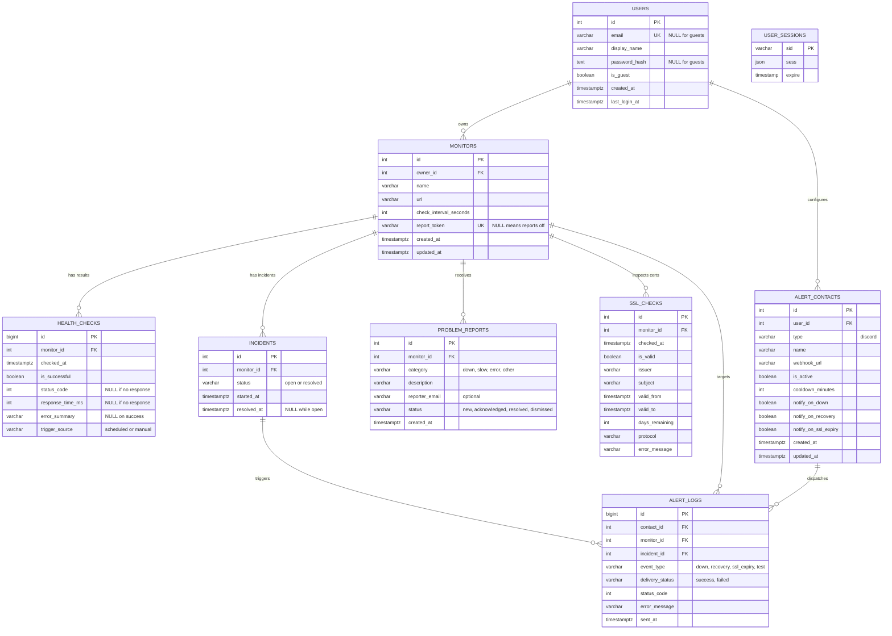

# Pulse: Architecture
> The heartbeat of your infrastructure.
> DBMS Laboratory (24CS305/CS3106) group mini project.
> This document describes the design only. SQL, schema files and application code live in the repository (`backend/drizzle/`, `backend/src/`).

## 1. Overview
Pulse is a lightweight monitoring platform for HTTP and HTTPS infrastructure. Users register sites as **monitors**; Pulse checks them on a schedule, records every result, opens **incidents** when services fail, inspects **TLS/SSL certificate validity**, dispatches real-time **Discord alerts**, and presents status, history, uptime and response-time charts on a modern editorial dashboard. An opt-in, unguessable **report link** per monitor lets external visitors report outages with bot-protection safeguards.

### Design principles
(1) **The database is the core.** The incident lifecycle, the guest tier limit, and data retention live in PostgreSQL as triggers, constraints, views, a function and a procedure, not scattered in application code.  
(2) **Every table earns its place.** Each of the 9 tables supports a feature that works end to end.  
(3) **Simple first.** One Express process, one in-process scheduler, no distributed queue or broker; the core monitoring loops work robustly before adding operational overhead.  
(4) **Secure by default.** SSRF guard, server-side ownership checks, strict input validation, safe redirects, and rate limiting protect against external manipulation.

### Scope
**Included**
- The core loop: **monitor, health check, incident, report**
- DBMS showcase pieces: `v_monitor_status` view, `v_monitor_ssl_status` view, `v_incident_details` view, uptime-summary function (`fn_monitor_uptime_summary`), incident trigger (`trg_health_checks_incident_lifecycle`), guest-limit trigger (`trg_monitors_guest_limit`), partial unique index, `CHECK` constraints, deliberate foreign-key behaviour
- SSRF safeguards: DNS address checks, blocked IP ranges, hop-by-hop redirect validation, timeouts
- Search, filter, check history, and multi-range latency and uptime charts (1h, 24h, 7d, 30d)
- Guest tier accounts (up to 2 monitors) with seamless in-place upgrade to registered status
- **TLS/SSL certificate monitoring**: automated remote certificate inspection, protocol checks, expiry countdowns (`days_remaining`), and validity tracking
- **Discord Webhook Alerts**: real-time outage, recovery, and certificate expiration alerts with rate-limit cooldowns, payload deduplication, and delivery auditing (`alert_logs`)
- **Rocket Theme Switcher**: bidirectional light/dark theme system powered by native View Transitions API and GSAP rocket animation with dynamic flame-aperture clipping
- Opt-in unguessable public report tokens per monitor with honeypot bot defense
- Data retention via stored procedure `sp_purge_old_checks`

Pulse uses **9 tables** (8 domain tables plus the session store).

**Not included:** admin role, WebSockets, SMS/PagerDuty, server agents, multi-region probes.  
**Deferred:** maintenance windows, public status page custom domains.

---

## 2. Technology Stack
| Layer | Choice |
|---|---|
| Frontend | React 18 (SPA), Vite, Tailwind CSS, React Router, Recharts, Framer Motion, GSAP, TypeScript |
| Backend | Node.js, Express, TypeScript (`tsx` in dev, `tsc` for build) |
| ORM and migrations | Drizzle ORM, Drizzle Kit |
| Database | PostgreSQL 15+, accessed through the `pg` driver |
| Auth | Server-side sessions (`express-session` with `connect-pg-simple`, no Redis), Argon2id password hashing (bcrypt fallback) |
| Validation | `zod` on the backend, light validators on the frontend |
| Testing | Vitest and Supertest (API and lifecycle), plain SQL scripts for DB objects |

Not used: Prisma, Sequelize, Knex, TypeORM, Flask, Python, Redis, message brokers, microservices, Kubernetes.

---

## 3. System Architecture

### 3.1 System diagram
```
 Browser (React SPA - View Transitions + Tailwind)
      |  JSON over HTTP, session cookie (pulse.sid)
      v
 +--------------------------------------------------------------+
 |  Express application (single process)                        |
 |   middleware: session, origin check, rate limit, validation  |
 |   routes -> controllers -> services -> db/queries            |
 |   health/ : ssrfGuard, httpChecker, sslChecker, scheduler    |
 |   alerts/ : discordDispatcher (embeds, deduplication)        |
 +-------------------------+------------------------------------+
                           |  Drizzle + pg (parameterized SQL)
                           v
 +--------------------------------------------------------------+
 |  PostgreSQL                                                  |
 |   9 tables + constraints   3 views   function/procedure      |
 |   triggers: incident lifecycle, guest monitor limit          |
 |   user_sessions (session store)                              |
 +--------------------------------------------------------------+

 Monitored targets: real HTTP/HTTPS sites, or local demo target (port 4100)
 External visitors: public report submission via unguessable token
 Outbound alerts: Discord webhook channels
```

### 3.2 Who owns what (no duplicated logic)
| Concern | Express service | PostgreSQL |
|---|---|---|
| Validate input, authenticate, authorize ownership | Yes | No |
| SSRF guard, perform HTTP request, measure latency | Yes | No |
| Record a check result | **Only writer** of `health_checks` (single INSERT) | Constraints validate row |
| **Incident lifecycle** (open, deduplicate, resolve) | **Never writes `incidents`** | **Sole owner**, via trigger on `health_checks` |
| Problem reports | Validates, rate-limits, stores | Constraints; `recent_reports_15m` computed in `v_monitor_status` |
| Guest limit of 2 monitors | Maps error to HTTP 403 | **Authoritative**, via trigger on `monitors` |
| Current status, durations, uptime | Reads views and function | Computes them (`v_monitor_status`, `fn_monitor_uptime_summary`) |
| Data retention | Calls procedure on schedule | `sp_purge_old_checks` deletes old rows |
| TLS/SSL inspection | Performs TLS handshake, extracts certificate | Stores in `ssl_checks`; `v_monitor_ssl_status` computes validity |
| Discord alert delivery | Dispatches webhook with cooldown checks | Stores destinations (`alert_contacts`) and delivery audit (`alert_logs`) |

Rule for code review: application code contains no `INSERT`, `UPDATE` or `DELETE` on `incidents`. A database trigger is the sole writer.

### 3.3 Users and access levels
| State | Created by | Can do |
|---|---|---|
| Anonymous (no session) | N/A | See login, register and "Continue as guest" |
| Public visitor (no session) | A monitor's report link | Submit a problem report for that one monitor |
| **Guest** | `POST /api/auth/guest` | Full monitor features on **at most 2 monitors**; temporary session |
| **Registered** | `POST /api/auth/register` | Full monitor features, unlimited monitors, account profile & password management, Discord alerts configuration |

Registering from a guest session **upgrades that same row** inside a database transaction, retaining the guest's monitors and history.

### 3.4 REST API summary
Base path `/api`, JSON in and out, session cookie `pulse.sid`. Success bodies use camelCase; lists return items, page, pageSize and total. Another user's resource returns **404**, not 403, preventing resource enumeration.

| Endpoint | Auth | Purpose |
|---|---|---|
| `POST /auth/register` | none or guest | Create account; upgrades a guest session in place |
| `POST /auth/login`, `POST /auth/logout` | none, session | Log in and out |
| `POST /auth/guest`, `GET /auth/me` | none, session | Start a guest session; current user (`monitorLimit: 2` for guests) |
| `PATCH /account`, `POST /account/password`, `DELETE /account` | session | Profile, password change, delete account and cascade |
| `GET /monitors`, `POST /monitors` | session | List (search, status, paging); create (403 `GUEST_LIMIT_REACHED` at 2 for guests) |
| `GET/PATCH/DELETE /monitors/:id` | session | Read, edit, delete (owner only) |
| `POST /monitors/:id/check` | session | Manual health check (rate-limited) |
| `GET /monitors/:id/history` | session | Check history, filter by result and date |
| `GET /monitors/:id/summary` | session | Uptime summary for 1h, 24h, 7d, 30d from `fn_monitor_uptime_summary` |
| `GET /monitors/:id/response-times` | session | Chart data points for 1h, 24h, 7d, 30d |
| `POST/DELETE /monitors/:id/report-link` | session | Enable or rotate / disable the public report link |
| `GET /monitors/:id/ssl`, `POST /monitors/:id/ssl/check` | session | Read latest SSL inspection / trigger immediate TLS check |
| `GET/POST /alerts/contacts` | session | List and create Discord alert webhooks |
| `GET/PATCH/DELETE /alerts/contacts/:id` | session | Read, update, delete alert contact |
| `POST /alerts/contacts/:id/test` | session | Dispatch test notification to Discord webhook |
| `GET /alerts/logs` | session | View alert delivery audit trail |
| `GET /problem-reports`, `PATCH /problem-reports/:id` | session | List received reports; triage status |
| `GET/POST /public/report/:token` | none | Public monitor status; submit report (honeypot protected) |
| `GET /incidents` | session | Incidents from `v_incident_details` |
| `GET /dashboard`, `GET /health` | session, none | Dashboard metrics; liveness probe |

---

## 4. Data Model

### 4.1 Relational schema
```
users(id PK, email UNIQUE NULL, display_name NULL, password_hash NULL, is_guest NOT NULL DEFAULT false, created_at NOT NULL DEFAULT now(), last_login_at NULL)

monitors(id PK, owner_id FK -> users.id ON DELETE CASCADE, name NOT NULL, url NOT NULL, check_interval_seconds NOT NULL DEFAULT 60, report_token UNIQUE NULL, created_at, updated_at, UNIQUE(owner_id, url))

health_checks(id PK, monitor_id FK -> monitors.id ON DELETE CASCADE, checked_at NOT NULL DEFAULT now(), is_successful NOT NULL, status_code NULL, response_time_ms NULL, error_summary NULL, trigger_source NOT NULL DEFAULT 'scheduled')

incidents(id PK, monitor_id FK -> monitors.id ON DELETE CASCADE, status NOT NULL DEFAULT 'open', started_at NOT NULL DEFAULT now(), resolved_at NULL)

problem_reports(id PK, monitor_id FK -> monitors.id ON DELETE CASCADE, category NOT NULL, description NOT NULL, reporter_email NULL, status NOT NULL DEFAULT 'new', created_at NOT NULL DEFAULT now())

user_sessions(sid PK, sess NOT NULL, expire NOT NULL)

ssl_checks(id PK, monitor_id FK -> monitors.id ON DELETE CASCADE, checked_at NOT NULL DEFAULT now(), is_valid NOT NULL, issuer NULL, subject NULL, valid_from NULL, valid_to NULL, days_remaining NULL, protocol NULL, error_message NULL)

alert_contacts(id PK, user_id FK -> users.id ON DELETE CASCADE, type NOT NULL DEFAULT 'discord', name NOT NULL, webhook_url NOT NULL, is_active NOT NULL DEFAULT true, cooldown_minutes NOT NULL DEFAULT 15, notify_on_down NOT NULL DEFAULT true, notify_on_recovery NOT NULL DEFAULT true, notify_on_ssl_expiry NOT NULL DEFAULT true, created_at, updated_at)

alert_logs(id PK, contact_id FK -> alert_contacts.id ON DELETE SET NULL, monitor_id FK -> monitors.id ON DELETE CASCADE, incident_id FK -> incidents.id ON DELETE SET NULL, event_type NOT NULL, delivery_status NOT NULL, status_code NULL, error_message NULL, sent_at NOT NULL DEFAULT now())
```

### 4.2 ER diagram


### 4.3 Normalization to 3NF
- **1NF**: Every column contains atomic values; no arrays or multi-value fields.
- **2NF**: All non-key attributes are fully functionally dependent on the primary key (all tables utilize single-column surrogate keys).
- **3NF**: No transitive dependencies exist. Attributes depend strictly on candidate keys.

#### Functional dependencies
| Table | Candidate Keys | Dependencies | 3NF? |
|---|---|---|---|
| `users` | `id`, `email` (when not null) | `id -> email, display_name, password_hash, is_guest, created_at, last_login_at` | Yes |
| `monitors` | `id`, `(owner_id, url)`, `report_token` (when not null) | `id -> owner_id, name, url, check_interval_seconds, report_token, created_at, updated_at` | Yes |
| `health_checks` | `id` | `id -> monitor_id, checked_at, is_successful, status_code, response_time_ms, error_summary, trigger_source` | Yes |
| `incidents` | `id`, `(monitor_id) WHERE status = 'open'` | `id -> monitor_id, status, started_at, resolved_at` | Yes |
| `problem_reports` | `id` | `id -> monitor_id, category, description, reporter_email, status, created_at` | Yes |
| `ssl_checks` | `id` | `id -> monitor_id, checked_at, is_valid, issuer, subject, valid_from, valid_to, days_remaining, protocol, error_message` | Yes |
| `alert_contacts` | `id` | `id -> user_id, type, name, webhook_url, is_active, cooldown_minutes, notify_on_down, notify_on_recovery, notify_on_ssl_expiry, created_at, updated_at` | Yes |
| `alert_logs` | `id` | `id -> contact_id, monitor_id, incident_id, event_type, delivery_status, status_code, error_message, sent_at` | Yes |
| `user_sessions` | `sid` | `sid -> sess, expire` | Yes |

### 4.4 Constraints plan
| Table | Constraint | Purpose |
|---|---|---|
| `users` | `CHECK` guest shape: guest rows have no email or password; registered rows have both and a display name | Prevents invalid account shapes |
| `users` | `CHECK (email = lower(email))`, `UNIQUE (email)` | Case-insensitive unique email |
| `monitors` | `UNIQUE (owner_id, url)` | No duplicate URL per owner |
| `monitors` | `CHECK` interval between 30 and 3600; `CHECK` URL starts with `http://` or `https://`; `CHECK` name not blank | Data integrity at DB layer |
| `health_checks` | `CHECK` status code null or 100 to 599; response time null or >= 0 | Valid metrics |
| `health_checks` | `CHECK` success has no error text and failure has error text | Consistent outcome |
| `health_checks` | `CHECK` trigger source in (`scheduled`, `manual`) | Controlled vocabulary |
| `incidents` | `CHECK` status in (`open`, `resolved`) | Controlled vocabulary |
| `incidents` | `CHECK` lifecycle: open means `resolved_at` is null; resolved means `resolved_at` is set and >= `started_at` | Status and timestamp consistency |
| `incidents` | **Partial unique index** on `(monitor_id) WHERE status = 'open'` | **At most one open incident per monitor, enforced by PostgreSQL** |
| `ssl_checks` | `CHECK (days_remaining BETWEEN -36500 AND 36500)` | Valid bounds on expiry duration |
| `alert_contacts`| `CHECK (type IN ('discord'))` | Controlled channel type |
| `alert_contacts`| `CHECK (cooldown_minutes BETWEEN 1 AND 1440)` | Sensible bounds on alert frequency |
| `alert_contacts`| `CHECK (webhook_url ~* '^https://(discord\.com\|discordapp\.com)/api/webhooks/')` | Webhook URL domain validation |
| `alert_logs` | `CHECK (event_type IN ('down', 'recovery', 'ssl_expiry', 'test'))` | Controlled event types |
| `alert_logs` | `CHECK (delivery_status IN ('success', 'failed'))` | Controlled status outcomes |

### 4.5 Migration strategy
Managed through `backend/drizzle/`:
1. `0000_init_tables.sql`: 6 foundational tables, constraints, partial unique index.
2. `0001_views.sql`: `v_monitor_status`, `v_incident_details`.
3. `0002_functions_procedures.sql`: `fn_monitor_uptime_summary`, `fn_guest_monitor_limit`, `sp_purge_old_checks`.
4. `0003_triggers.sql`: Incident lifecycle trigger, guest limit trigger.
5. `0004_ssl_and_discord_alerts.sql`: `ssl_checks`, `alert_contacts`, `alert_logs`, `v_monitor_ssl_status`, updated `v_monitor_status`.

---

## 5. Database Logic

### 5.1 Triggers
- `trg_health_checks_incident_lifecycle`: `AFTER INSERT` on `health_checks`.
  - Failed check: Opens an incident unless one is already open (race-free via partial unique index `ON CONFLICT DO NOTHING`).
  - Successful check: Resolves any active incident for the monitor, setting `resolved_at = GREATEST(NEW.checked_at, started_at)`.
- `trg_monitors_guest_limit`: `BEFORE INSERT` on `monitors`.
  - Locks the owner's row in `users`. If `is_guest = true` and count >= 2, raises exception with SQLSTATE `GL001`.

### 5.2 Views
- `v_monitor_status`: Combines monitor configuration, latest health check via `LATERAL` subquery, active incident flag, recent 15-minute problem report count, and latest SSL validity/days remaining.
- `v_incident_details`: Provides incident metadata, duration in seconds, count of failed checks during the incident, and root cause error message via `LATERAL` join.
- `v_monitor_ssl_status`: Extracts the latest SSL certificate inspection details per monitor.

### 5.3 Functions and procedures
- `fn_monitor_uptime_summary(monitor_id, from_time, to_time)`: Computes exact total checks, successful checks, uptime %, and response time statistics (min, avg, max) over any specified time window.
- `fn_guest_monitor_limit()`: Returns constant 2; single source of truth for trigger and frontend display.
- `sp_purge_old_checks(days)`: Purges health check records older than the specified retention window (minimum 7 days).

---

## 6. Key Flows

### 6.1 Scheduled Health Check Flow
1. Scheduler tick (every 15s) retrieves due monitors from `v_monitor_status`.
2. Concurrency is limited to 5 in-flight checks.
3. For each target, `ssrfGuard` validates the hostname and IP destination.
4. HTTP request executes with a 10s timeout and 64 KB size limit.
5. Result is written in a single `INSERT` into `health_checks`.
6. Database trigger evaluates incident transition. If state changes, Discord alert dispatcher is triggered.

### 6.2 SSL Certificate Inspection Flow
1. Periodic scheduler or manual button (`POST /api/monitors/:id/ssl/check`) triggers inspection.
2. TLS socket establishes a secure handshake to the target host and port 443 with SNI.
3. Node TLS engine extracts peer certificate metadata (validity dates, issuer, subject, protocol).
4. Days until expiration is calculated (`(validTo - now) / 86400000`).
5. Record is persisted in `ssl_checks`.
6. If the certificate is expiring soon (<= 14 days) or invalid, the alert dispatcher evaluates notification delivery.

### 6.3 Discord Alert Dispatch & Cooldown Flow
1. Event occurs: Incident Opened (`down`), Incident Resolved (`recovery`), or SSL Expiry Warning (`ssl_expiry`).
2. Dispatcher queries active `alert_contacts` configured for the monitor's owner.
3. For each contact, the dispatcher inspects `alert_logs` for recent delivery within `cooldown_minutes`.
4. If cooldown has elapsed, it builds a Discord rich embed with status color (`#ef4444` red for outage, `#22c55e` green for recovery, `#f59e0b` amber for SSL) and dispatches via HTTPS POST.
5. Audit record is inserted into `alert_logs`.

### 6.4 Rocket Theme Switcher Flow
1. User clicks the Sun/Moon toggle button.
2. View Transitions API initializes via `document.startViewTransition()`.
3. In `flushSync`, React updates the theme state and toggles the `.dark` class on `<html>`.
4. Web Animations API generates 60 keyframes of the flame aperture clipping path (`M C L L L C Z`) and animates `::view-transition-new(root)` or `::view-transition-old(root)`.
5. GSAP drives the rocket SVG along the flame apex using linear smoothstep progression.
6. Upon transition completion, the Web Animations instance is explicitly cancelled (`anim.cancel()`), preventing forward-filling keyframe leaks on future transitions.

---

## 7. Security Architecture
- **SSRF Guard**: Prohibits private networks (`10.0.0.0/8`, `172.16.0.0/12`, `192.168.0.0/16`), loopbacks (`127.0.0.1`, `::1`), link-local metadata (`169.254.169.254`), multicast, and IPv4-mapped IPv6. Custom DNS resolver validates the actual IP address connected.
- **Session Security**: `HttpOnly`, `SameSite=Lax`, `Secure` in production, regenerated session IDs on login/upgrade/logout.
- **Authorization**: All database queries strictly scope to `owner_id`. Foreign resources return 404 to avoid ID enumeration.
- **Bot Mitigation**: Public problem report endpoint features honeypot fields (`website`), IP rate limits, and unguessable 32-character tokens.

---

## 8. Project Structure
```
pulse/
|- backend/
|  |- drizzle/             # 0000_init, 0001_views, 0002_functions, 0003_triggers, 0004_ssl_alerts
|  |- src/
|  |  |- db/               # schema.ts, relations.ts, views.ts, queries/
|  |  |- middleware/       # session, requireUser, originCheck, rateLimit, validate
|  |  |- modules/          # auth, account, monitors, incidents, reports, public, dashboard, alerts
|  |  |- health/           # ssrfGuard, checker, sslChecker, checkService, scheduler
|  |  `- server.ts, app.ts, config/env.ts
|  |- scripts/             # seed.ts, reset-db.ts, dump-sql.ts
|  `- demo/target-server.ts
|- frontend/src/
|  |- api/                 # API client (monitors, incidents, reports, ssl, alerts)
|  |- auth/, hooks/, lib/  # flamePath.ts
|  |- context/             # ThemeContext.tsx, useTheme.ts
|  |- pages/               # Dashboard, Monitors, MonitorDetail, Incidents, Reports, Account, Login
|  `- components/          # layout, ui (RocketLayer, ThemeToggle), charts (Recharts), monitors (SslCertificateCard)
|- docs/                   # api.md, architecture.md, demo-script.md
`- README.md
```
